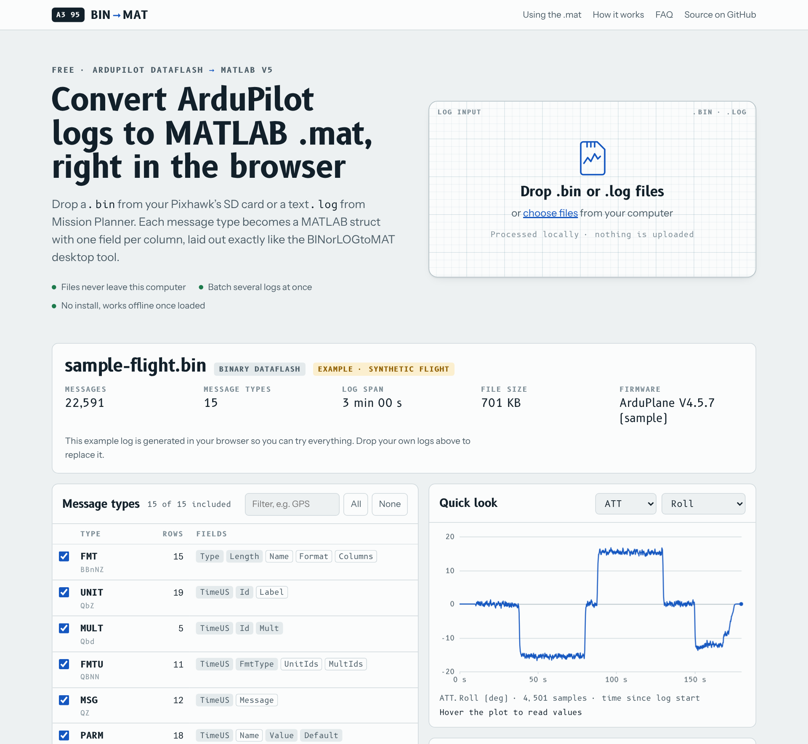

# BIN to MAT: ArduPilot log to MATLAB converter

**Convert ArduPilot DataFlash logs (`.bin` and Mission Planner `.log`) to MATLAB `.mat` files in your browser. It's free, nothing is uploaded and there's nothing to install.**

### ▶ [Open the converter: dompka.github.io/bintomat](https://dompka.github.io/bintomat/)

[](https://dompka.github.io/bintomat/)

BIN to MAT reads the flight logs that ArduPilot writes on Pixhawk, Cube and other flight controllers (ArduCopter, ArduPlane, ArduRover, ArduSub). It turns every message type (`ATT`, `GPS`, `IMU`, `BARO`, `RCOU`, `PARM`, …) into a MATLAB struct with one field per log column. It's the web version of the **BINorLOGtoMAT** desktop tool, with the same output layout.

## Features

- **Reads binary `.bin` logs** from the SD card, or downloaded with Mission Planner, QGroundControl or MAVProxy, and **text `.log` files** exported by Mission Planner.
- **Writes MATLAB v5 MAT-files**, which load with `load` in MATLAB, `scipy.io.loadmat` in Python and `load` in GNU Octave.
- **Keeps your data private.** Logs are parsed with JavaScript on your own computer and never uploaded. Once the page has loaded it also works offline.
- **Converts many logs in one go.** Drop several logs and download each `.mat`, or all of them in one `.zip`.
- **Lets you pick message types.** Untick high-rate messages such as `IMU` or `ISBD` for a smaller file.
- **Compresses the output** if you want. MATLAB opens compressed MAT-files natively.
- **Stores integers as `int64` or `double`.** `int64` is the desktop tool's default; `double` makes the maths in MATLAB simpler.
- **Includes a quick-look plot** of any numeric field, with units read from the log, so you can check the data before downloading.

## How to use it

1. Open **https://dompka.github.io/bintomat/**.
2. Drop one or more `.bin` / `.log` files on the page, or click **choose files**.
3. Optionally untick message types, rename the file or change the options, then press **Download .mat**.

### MATLAB

```matlab
load('flight.mat')                      % ATT, GPS, BARO, IMU, ... appear in the workspace
t = double(ATT.TimeUS) / 1e6;           % TimeUS is int64 microseconds since boot
plot(t, ATT.Roll, t, ATT.DesRoll)
legend('Roll', 'DesRoll'); xlabel('Time (s)'); ylabel('deg')

names = strtrim(cellstr(PARM.Name));    % text fields are char matrices, one row per message
PARM.Value(strcmp(names, 'WP_LOITER_RAD'))

geoplot(GPS.Lat, GPS.Lng)               % Lat/Lng are already in degrees
```

### Python

```python
from scipy.io import loadmat
m = loadmat('flight.mat', squeeze_me=True, struct_as_record=False)
att = m['ATT']
t = att.TimeUS / 1e6
print(att.Roll[:10])
```

### How DataFlash types map to MATLAB

| DataFlash format | Logged as | In the `.mat` |
|---|---|---|
| `b B h H i I M` | 8 to 32-bit integers | `int64` row vector |
| `q Q` | 64-bit integers (e.g. `TimeUS`) | `int64` row vector |
| `f d g` | float, double, half float | `double` row vector |
| `c C e E` | integers scaled ×100 | `double`, divided by 100 |
| `L` | latitude/longitude as int32 ×10⁷ | `double` degrees |
| `n N Z` | char[4], char[16], char[64] | `char` matrix, N × width |
| `a` | int16[32] | `int16` N × 32 matrix |

## Same output as the desktop tool

The converter follows the reading rules of pymavlink's `DFReader` for both binary and text logs, and writes the file the same way `scipy.io.savemat` does. Field order, data types, string padding, value scaling and the handling of corrupt bytes all match the BINorLOGtoMAT desktop tool. With compression switched off the output is **byte-for-byte identical**, apart from the 116-byte text header that holds the creation date.

This was checked on:

- a real ArduPlane log, and a 20 MB log built from it with corrupt joins between the copies;
- synthetic logs that use all 21 DataFlash format characters, plus garbage bytes, unknown message IDs, a message with a wrong length, a mid-log format redefinition, messages logged before their FMT, and a truncated final message;
- Mission Planner style text `.log` files with CRLF line endings, unknown lines and short lines.

The browser converts a 20 MB log in about 0.5 s. The Python tool takes about 8 s for the same log.

Differences, all in edge cases:

- **Compression is on by default.** Switch it off for byte-identical output.
- **`FILE` messages with binary content.** The desktop tool writes raw bytes into a char array, which can make the `.mat` unreadable. The web version maps each byte to one character, so the file always loads.
- **`Q` values of 2⁶³ or more** are stored as `uint64`.
- **PX4 `.ulg` and MAVLink `.tlog` logs** are not supported.

## Limits

The whole log is read into browser memory. Logs of several hundred MB work in desktop Chrome, Edge and Firefox; a 200 MB log takes about 5 s. The MAT v5 format limits a single variable (one message type) to 4 GB.

## Development

The site is one self-contained `index.html` with no dependencies and no build tools needed to run it. The readable sources are in [`src/`](src):

| File | What it does |
|---|---|
| `src/converter.js` | DataFlash parser (binary and text) and MAT v5 writer. It also runs in Node ≥ 18 with `require('./src/converter.js')`. |
| `src/app.js` | The page: file handling, message table, quick-look plot, downloads. |
| `src/sample.js` | Builds the synthetic example flight shown when the page opens. |
| `src/page.html.tpl` | Markup and styles. |

After editing the sources, run `node build.js` to regenerate `index.html` and `sitemap.xml`, then commit. GitHub Pages serves the repository root.

Converting a log from Node:

```js
const fs = require('fs');
const BinMat = require('./src/converter.js');
(async () => {
  const log = await BinMat.parse(fs.readFileSync('00000042.BIN'));
  const blob = await BinMat.toMat(log, { compress: true });
  fs.writeFileSync('00000042.mat', Buffer.from(await blob.arrayBuffer()));
})();
```

## Credits

- The parsing rules follow [pymavlink](https://github.com/ArduPilot/pymavlink)'s DataFlash reader, and the output layout follows [SciPy](https://scipy.org/)'s `savemat`. No code from either project is included.
- Typefaces: [B612](https://github.com/polarsys/b612) (designed for Airbus cockpit displays) and [Instrument Sans](https://github.com/Instrument/instrument-sans), both loaded from Google Fonts under the SIL Open Font License.
